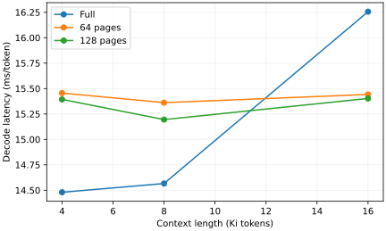
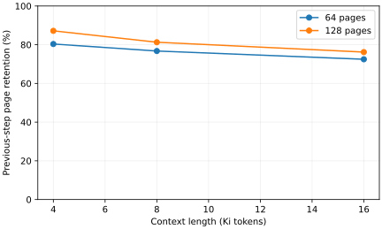

# Quest Blackwell baseline：验收与测量报告

本报告记录已有工作的验收、失败修复与后续实验结果。所有数字由本地实验文件生成。

## 实现与环境

- GPU：NVIDIA RTX PRO 6000 Blackwell Workstation Edition，计算能力 [12, 0]。
- Python 3.10.12；PyTorch 2.7.1+cu128；CUDA runtime 12.8；Transformers 4.45.2。
- CUDA compiler 12.8.93、host GCC 13；单卡、batch=1、FP16、页大小 16。
- 模型：LongChat-7B-v1.5-32K；revision `389eea141540fe7d2c314eacdfe980ae1415c6c0`。
- 复用原 CUDA 页评分和分区分页注意力 kernel；Top-K 使用 torch.topk；HND 存储；PyTorch 更新缓存与元数据；SDPA prefill。
- 前两层完整注意力，尾页强制保留且计入预算。完整对照也使用同一个原生分页注意力后端。
- 与论文存在后端、布局、调度计划缓存和硬件差异，结果属于本适配实现；未使用论文端到端加速实验中的 4-bit 权重量化。

## 完成情况与验收

| 工作 | 验收结果 |
| --- | --- |
| 原 MaxPossible FP16 测试矩阵 | 通过；见 results/baseline/max_possible.log |
| 新适配数值测试 | 页评分、尾页、完整预算与 HF 对照、CUDA Graph 重放均通过 |
| profiler 分析测试 | 按调用归属及重叠 GPU 工作区间计算通过 |
| 性能矩阵 | 18 个配置，90 条运行记录 |
| 逐层/逐步/逐头选页轨迹 | 294,912 条，完整性、索引、尾页与预算检查通过 |
| 布局配对实验 | 六个真实 Q/KV 快照，四种布局/顺序变体；Graph 重放输出一致 |
| 硬件计数器 | 未完成：Nsight Compute 2025.1.1 识别 GPU，但驱动返回 ERR_NVGPUCTRPERM |

## 扩展精度评测

每个预算使用同一批 100 条、精确 10,000 token 的合成 Passkey 输入。
五个插入深度各 20 条；最后 64 个输入 token 逐个处理，随后最多 greedy 生成 10 tokens。
输入 IDs、哈希、答案及预测逐条保存；这是明确记录协议差异的检索 baseline，并非完整论文任务集合。

| 页预算 | 对应 token 预算 | 正确数 | 准确率 | Wilson 95% 区间 |
| --- | --- | --- | --- | --- |
| 完整 | 完整 | 100/100 | 100.0% | 96.3%–100.0% |
| 64 | 1024 | 100/100 | 100.0% | 96.3%–100.0% |
| 128 | 2048 | 100/100 | 100.0% | 96.3%–100.0% |

各深度结果见 `results/baseline/passkey-10k-100/accuracy_summary.json`。

## 性能基线

固定 replay 输入，真实模型执行 16 个 teacher-forced decode 步。每个配置预热一次、测量三次。
下表是未启用逐阶段插桩/选页复制的运行均值；每次运行仍有逐步 CUDA events。
三次运行使用同一个合成输入，不能代表不同文档的统计置信区间。

| 上下文 tokens | 完整 ms/步 | 64 页 ms/步 | 相对完整加速 | 128 页 ms/步 | 相对完整加速 |
| --- | --- | --- | --- | --- | --- |
| 4096 | 14.480 | 15.456 | 0.937× | 15.393 | 0.941× |
| 8192 | 14.566 | 15.362 | 0.948× | 15.195 | 0.959× |
| 16384 | 16.256 | 15.442 | 1.053× | 15.403 | 1.055× |

4K/8K 的稀疏路径未取得端到端收益；16K 有小幅收益。不能只根据选中 token 数推算模型加速。

## 各阶段时间及测量边界

8K、64 页，逐阶段 profiler 的纯 kernel 时间与单独阶段 event 区间如下。
融合注意力一项包含读取、计算和分区结果合并；其平均值混合前两层完整与后续稀疏层。
event 区间可能包含 host 发射间隙，不能将其直接相加作为未插桩模型的耗时分解。

| 阶段 | 每层每步 kernel 时间均值 µs | 阶段 event 区间均值 µs |
| --- | --- | --- |
| page_score | 11.475 | 49.747 |
| topk | 6.280 | 49.127 |
| kv_append_metadata | 9.311 | 81.023 |
| kv_read_attention_fused | 19.518 | 52.009 |

独立 KV gather + SDPA 的结果只用于诊断。gather 含索引处理、读取和写出；SDPA 会再次读取 KV。
两项耗时不等于原融合 kernel 内的读取/计算分解。

8K、64 页真实快照在 CUDA Graph 热缓存诊断中的中位数：

| 诊断操作 | µs/次 |
| --- | --- |
| fused | 7.015 |
| gather_diagnostic | 30.209 |
| sdpa_diagnostic | 11.324 |

融合路径避免了独立 gather 的物化过程；该诊断实现的额外开销不能归因于地址不连续。

## 页复用

同层同查询头，相邻步选中历史页的保留比例；排除强制尾页和前两层完整注意力：

| 上下文 tokens | 64 页保留比例 | 128 页保留比例 |
| --- | --- | --- |
| 4096 | 80.36% | 87.17% |
| 8192 | 76.74% | 81.28% |
| 16384 | 72.48% | 76.19% |

存在同头跨步重复选页，但这只是复用机会，未证明数据留在 L2。合成文本与固定 replay 序列会影响复用率。
每个 layer/head 的保留率见 `head_temporal_reuse.jsonl`，高频页见 `page_popularity.jsonl`。
MHA 不同头以及不同层的相同逻辑页号对应不同 KV 字节，不将其统计为相同数据复用。

## 物理布局与访问顺序配对实验

取 layer 16、step 0 的真实 Q/KV；改变布局时同步重映射索引，尾页固定。
四个变体数值一致后，各捕获 50 次调用的 CUDA Graph，重复测量 20 个批次。
下表为融合注意力每次调用的中位数；均为反复访问相同数据的热缓存条件。

| 上下文/页预算 | 原布局原顺序 µs | 原布局排序 µs | 打乱布局原顺序 µs | 打乱布局排序 µs |
| --- | --- | --- | --- | --- |
| 16384-128 | 9.341 | 9.696 | 9.620 | 9.571 |
| 16384-64 | 7.030 | 7.216 | 7.161 | 7.307 |
| 4096-128 | 9.421 | 9.539 | 9.728 | 9.670 |
| 4096-64 | 6.948 | 7.357 | 7.207 | 7.239 |
| 8192-128 | 9.374 | 9.646 | 9.562 | 9.623 |
| 8192-64 | 7.015 | 7.153 | 7.259 | 7.303 |

这些配对结果没有给出地址离散导致明显性能损失的证据。它们只约束上述热缓存快照，
不能外推到模型层间缓存污染或冷缓存。请求字节数除以时间得到的 GB/s 不是实测 DRAM 带宽。

## 等待归属与 profiler 开销

逐阶段 profiler 中 GPU 工作间隙占跨度 73.8%；这一比例受到插桩显著影响。
下面各预算使用独立进程，先测未插桩运行，再测 CUDA-only profiler。
原同进程试验显示，首次 profiling 后的后续未插桩运行也变慢；原记录保留在 profile-minimal。

| 页预算 | 未插桩 ms/步 | CUDA-only profiler ms/步 | 开销比 | profiler GPU 间隙比例 |
| --- | --- | --- | --- | --- |
| 完整 | 14.712 | 19.759 | 1.34× | 32.8% |
| 64 | 15.226 | 20.451 | 1.34× | 43.7% |
| 128 | 15.549 | 20.971 | 1.35× | 43.5% |

GPU 空闲间隙与 kernel 内 warp 等待是不同概念。当前只能定位调度时间线与算子耗时；
无法在缺少硬件计数器时把 kernel 等待归因于 DRAM、L2 miss 或 barrier。
已尝试非交互管理员采集，sudo 返回 `a password is required`；需要本机管理员手动执行 README 中的命令。

## 修复与可复现材料

- 原直接非分区调用不满足特殊尾页寻址，已改为原分区 handler；数值测试未放宽。
- CUDA Graph 初次重放非法访存：capture stream 上未预建 plan，捕获了临时 host 向量的上传；现已在同一 stream 预建并验证重放输出。
- 原始失败日志保留，修复后的六组结果与新增回归测试单独保存。
- `evaluation/baseline/README.md` 给出构建、测试、精度、性能、布局和管理员计数器采集命令。
- `results/baseline/frozen/` 保存源码、环境、构建信息、二进制与实验结果索引；没有自动提交或推送 Git。

## 下一步决策

1. 管理员采集 DRAM/L2/warp-stall 计数器，并使用代表性快照与模型内执行交叉验证。
2. 在自然长文本及多个 prompt 上扩展轨迹，验证当前合成检索工作负载中的复用是否仍成立。
3. 依据数据比较元数据更新、选页、调度开销与注意力收益，再选择优化对象。当前不以页地址离散为优化依据。
